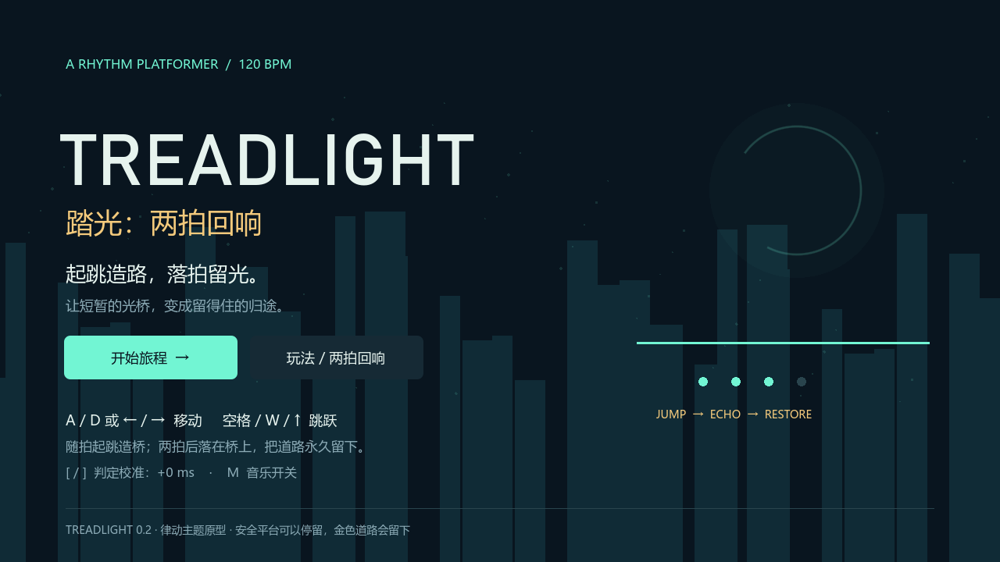

# 踏光：两拍回响 / Treadlight

**起跳造路，落拍留光。**

《踏光：两拍回响》是一款将音乐节拍与道路修复结合的 2D 节奏平台游戏。在沉寂的光之遗迹中，路途被一道道断隙分隔。你需要跟随节拍起跳，唤醒短暂的光桥，再用一次踩准节拍的落地，让光成为留得住的道路。

从一段临时的青桥，到一条稳定的金色通路，每次成功的起落都会改变眼前的空间。点亮全部共鸣点，开启出口，继续向前。

**v0.2 · Windows x64 · Godot 4.4.1 / GDScript**

[下载试玩](https://github.com/xunraozhou/treadlight/releases/tag/v0.2.0) · [游戏介绍](docs/project-introduction.md) · [游戏策划](docs/game-design.md) · [开发文档](docs/development.md)

## 用一次起落，留下一段路

音乐给出节拍，跳跃将它变成道路。

靠近虚线光桥，随拍从地面起跳，青色桥面便会出现。它只能维持四拍，你需要保持向前，约两拍后落在桥上。如果落地同样踩准节拍，青桥就会变成金桥，在本次房间尝试中持续保留，点亮一个共鸣点。

起跳与落地共同构成一次完整的回应：前者创造通路，后者将它留下。房间内的全部共鸣点修复后，通往下一段旅程的出口才会开启。

| 起跳造路 | 落拍留光 |
| --- | --- |
|  |  |
| 青桥持续四拍，最后一拍闪烁 | 金桥在本轮保留，点亮共鸣点 |

## 听见节拍，也看见节拍

游戏以 120 BPM 的音乐为时间基准。屏幕底部的四拍灯、角色周围的收缩光环与机关预警共同提示时机，让节奏能够通过声音和画面被感知。

普通跳跃随时可用，与踩拍跳跃保持相同的高度和轨迹。落地会自动判定，无需额外按键。你可以在安全平台等待下一拍，也可以在落拍失误后从任一岸重新尝试。

激光会提前一拍亮起金色虚线，再转为危险的实体光束。观察、等待、起跳，与修复光桥一起构成前进的节奏。

## 三个房间，一段回响

| 房间 | 旅程 |
| --- | --- |
| **唤醒余音** | 在没有激光干扰的空间里，唤醒第一座光桥，学会让光留下。 |
| **让光留下** | 穿过有预警的激光，在等待与起跳之间寻找安全的时机。 |
| **接续回响** | 接续两段光桥，完成全部共鸣，让终点亮起。 |

场景以深色几何遗迹为背景，用青色表现短暂的通路、金色表现已经留下的共鸣。随着道路被修复，空间逐渐恢复色彩，玩家的行动也在场景中留下可见的进展。

## 开始游戏

1. 前往 [v0.2 发布页](https://github.com/xunraozhou/treadlight/releases/tag/v0.2.0)，下载 `Treadlight-v0.2-Windows-x64.zip`。
2. 完整解压，保持 `Treadlight.exe` 与 `Treadlight.pck` 位于同一目录。
3. 双击 `Treadlight.exe`，选择“开始旅程”。首次游玩可先查看标题页的“玩法 / 两拍回响”。

Windows 试玩包无需安装 Godot。开场有四拍准备，之后即可移动与跳跃。

| 按键 | 操作 |
| --- | --- |
| A / D、← / → | 左右移动 |
| 空格、W、↑ | 地面起跳 |
| Enter | 开始、失败重试、过关继续 |
| R | 重新开始当前房间 |
| Esc | 暂停或继续；在结果页、帮助页返回标题 |
| [ / ] | 调整节拍判定校准，每次 10 ms |
| M | 音乐开关 |

不同耳机和显示设备可能带来延迟，可用 `[`、`]` 调整判定。设置会自动保存；正校准值表示接受稍晚于音乐节拍的输入。

## 开发与实现

项目使用 Godot 4.4.1 Standard 与 GDScript。音乐、起落判定、光桥、激光和视觉提示共享同一个节拍时钟，并补偿混音等待与音频输出延迟。几何画面由代码绘制，循环音轨通过 Python 标准库合成。

当前版本包含三个房间、规则教学、光桥修复、激光预警、计分、暂停、失败重试与通关结算。v0.2 已通过 54 项自动检查及三关角色物理路线验证；具体范围见[开发与验证说明](docs/development.md)，运行记录见 [GitHub Actions](https://github.com/xunraozhou/treadlight/actions)。

从源码运行：在发布页下载 `Treadlight-v0.2-source.zip`，或获取当前仓库，用 Godot 4.4.1 Standard 导入根目录的 `project.godot`，等待资源导入后按 F5。无需 .NET 或额外插件。

## 许可与致谢

项目代码采用 [Apache-2.0](LICENSE)。

代码、图形、音轨与依赖的来源记录见[素材与来源清单](docs/assets.md)及 [NOTICE](NOTICE)；Godot 引擎和内置依赖声明见 [THIRD_PARTY_NOTICES.md](THIRD_PARTY_NOTICES.md)。
