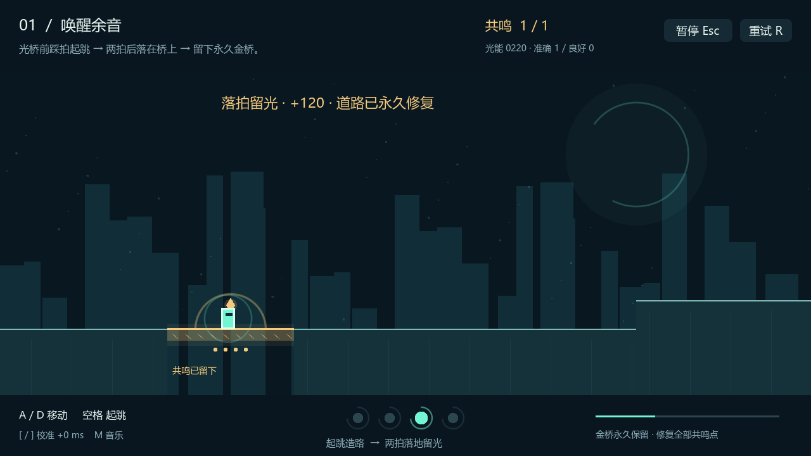
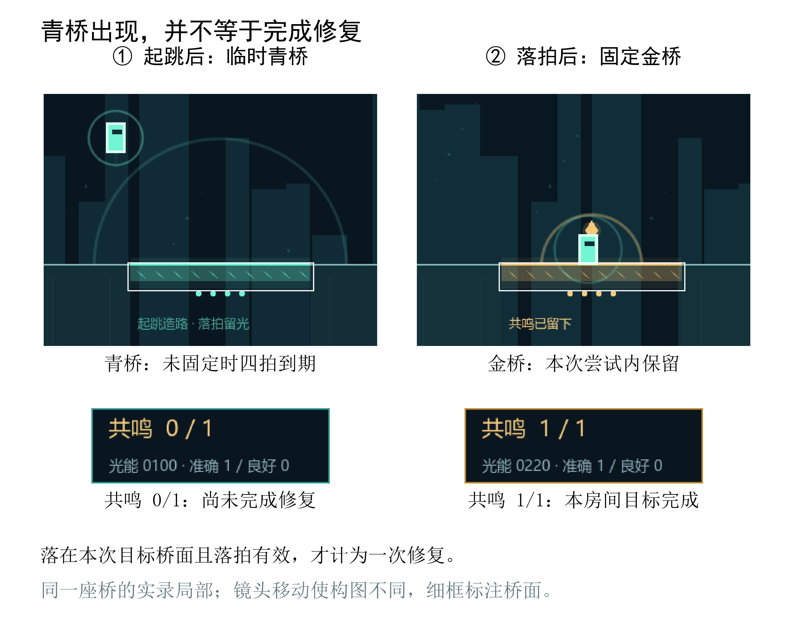
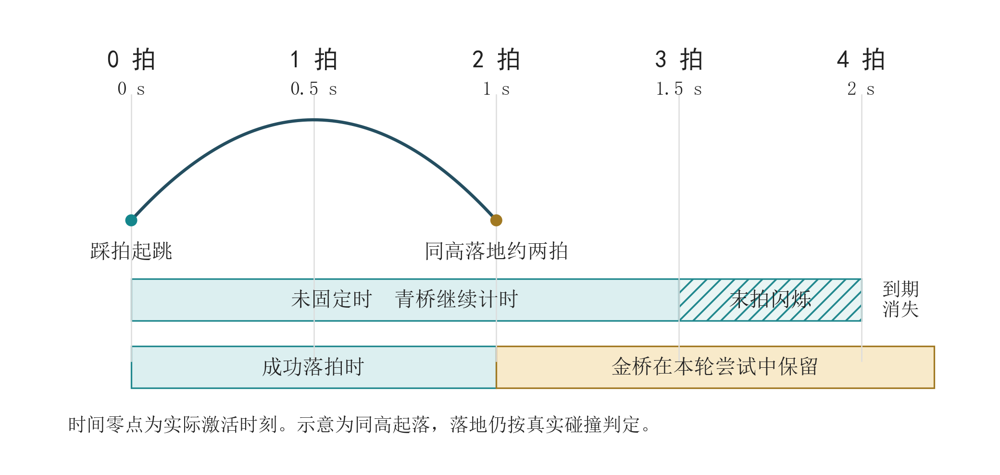
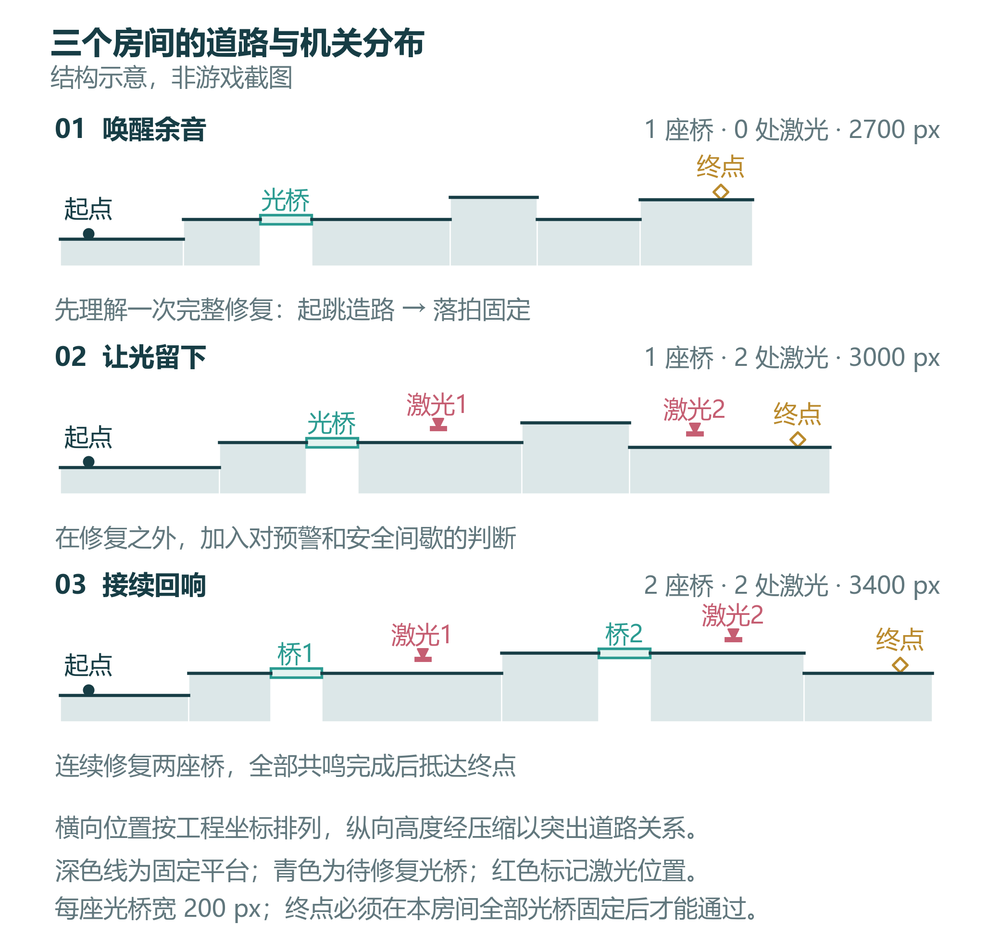
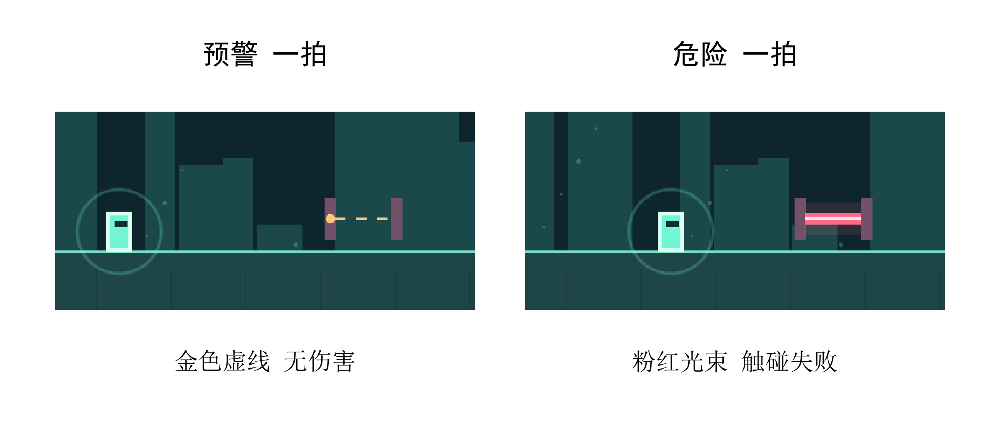
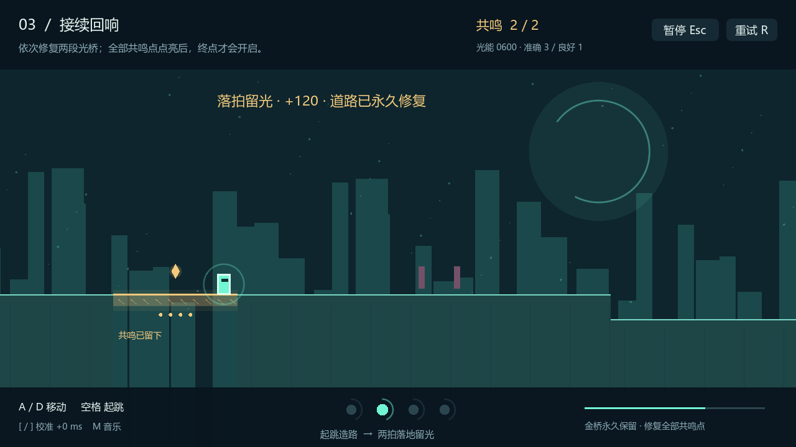
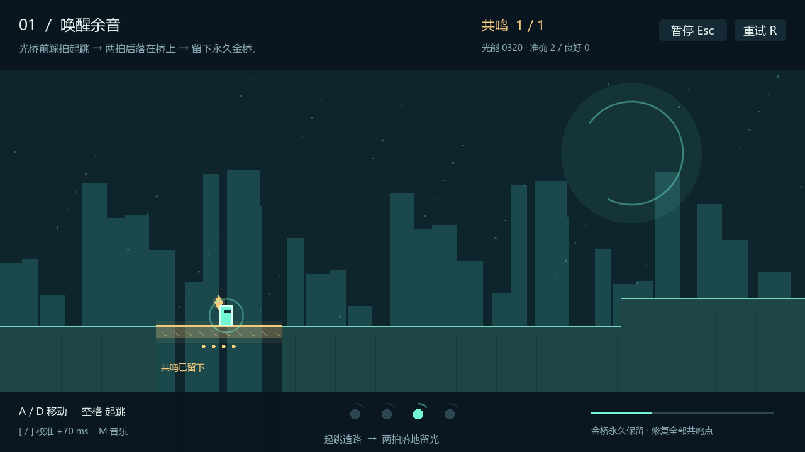
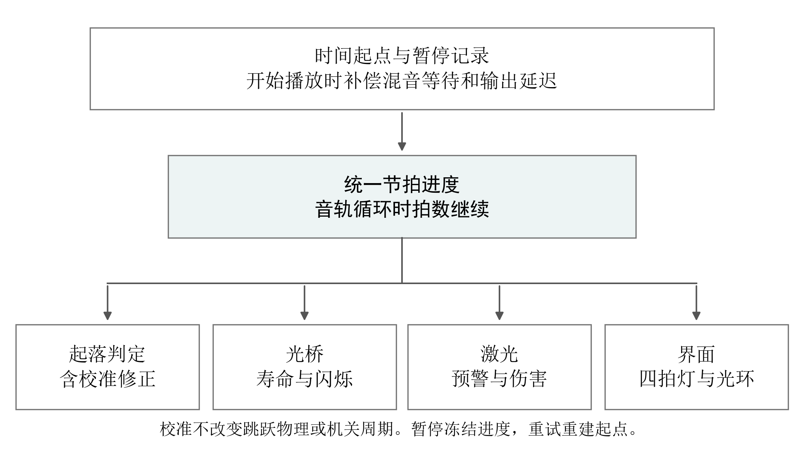

# 《踏光：两拍回响》作品设计报告

Treadlight · v0.2 · 2026年10月25日

[阅读作品设计报告 PDF](design/game-design.pdf) · [下载可编辑 Word](design/game-design.docx) · [人员分工](team-profile.md)

图 1  当前版本实录  一次落拍成功后留下的金色通路。

本作将节奏判断放进角色的实际起落，让踩拍动作改变通路状态，并留下继续前进的道路。玩家在三间遗迹中依次完成修桥、穿越危险与连续接续通路的挑战。

### 制作团队

严楷哲  队长  程序与版本统筹
沈语雯  策划  关卡与视觉
李星莹  音频  测试与展示材料

## 目录

- [作品概要](#作品概要)
- [一 设计立意](#一-设计立意)
- [二 核心机制](#二-核心机制)
  - [时间与空间的配合](#时间与空间的配合)
  - [容错与进程判断](#容错与进程判断)
- [三 关卡设计](#三-关卡设计)
  - [从理解规则到选择时机](#从理解规则到选择时机)
  - [接续回响与旅程收束](#接续回响与旅程收束)
- [四 视听与交互](#四-视听与交互)
  - [配乐与动作判定的衔接](#配乐与动作判定的衔接)
- [五 实现方式](#五-实现方式)
- [六 完成情况与验证](#六-完成情况与验证)
- [七 团队分工](#七-团队分工)
  - [严楷哲 队长与程序负责人](#严楷哲-队长与程序负责人)
  - [沈语雯 策划与视觉负责人](#沈语雯-策划与视觉负责人)
  - [李星莹 音频测试与展示负责人](#李星莹-音频测试与展示负责人)

## 作品概要

《踏光：两拍回响》是一款单人节奏平台跳跃游戏。玩家在暗色遗迹中修复断路：踩拍起跳唤醒持续四拍的青桥，随后在目标桥上踩拍落地，将其固定为金色通路。房间内的全部光桥固定后，出口开启。

作品把音乐中的拍点与角色的实际起落联系起来，使节奏判断产生可以行走、也可能消失的空间结果。当前版本包含三个房间，以及教学、暂停、失败重试、计分、校准和结算，提供 Windows x64 运行版本。工程使用 Godot 4.4.1 Standard 与 GDScript。

| 作品信息 | 当前版本 |
| --- | --- |
| 类型与操作 | 单人节奏平台跳跃；左右移动与地面单次跳跃 |
| 内容规模 | 三间房间，四座光桥，四处激光 |
| 核心目标 | 完成房间内全部光桥的修复，再抵达出口 |
| 运行与实现 | Windows x64；Godot 4.4.1 Standard；GDScript |

## 一 设计立意

### 让节拍影响前进方式

本作的设计从两项要求出发：角色必须保有清楚、稳定的跳跃轨迹，节拍又必须影响玩家如何前进。若只在起跳时显示评分，节奏与路线容易脱节；若每次踩拍都会改变跳跃高度，玩家又需要同时判断时间和不断变化的落点。

当前方案让普通跳跃和踩拍跳跃使用同一套运动参数，把节奏的作用放在环境上。有效起跳使桥面出现，落地回应决定它能否留下。玩家仍然控制横向移动与出发时机，前方可通行区域则随动作发生变化。一次跳跃因此包含两个需要相互配合的判断：什么时候离地，以及能否在下一次回应时落到目标上。

### 让变化留在环境中

“律动”贯穿动作与空间变化。断路的虚线轮廓表示尚未恢复的连接，青色实体表示短暂回应，金色通路表示本次修复完成。随着共鸣增加，环境逐步恢复色彩，终点也由关闭转为开启。世界观不另设长篇背景说明，玩家通过改变道路认识这片遗迹。

角色采用简洁的发光形体，场景由立柱、断隙、远处天体和细小光点组成。角色的身份没有展开为职业或能力成长，旅程的变化主要留在环境中。三个房间依次命名为“唤醒余音”“让光留下”“接续回响”，对应初次回应、稳定修复和连续连接的过程。

### 当前版本的取舍

| 保留的体验 | 落实方式 | 范围选择 |
| --- | --- | --- |
| 可预判的运动 | 普通跳跃与踩拍跳跃共用轨迹 | 节拍改变通路状态，不改变跳跃高度 |
| 可观察的进展 | 金桥、共鸣与环境颜色对应修复 | 叙事通过操作和空间变化展开 |
| 局部的行动压力 | 临时桥限时，固定平台可等待 | 不设置整间房间的通关倒计时 |

本作面向愿意尝试节奏与平台跳跃的玩家。操作集中在左右移动和单次起跳，挑战放在出发时机与落点的配合上。学习过程从识别一次修复开始，逐步转向对危险周期与连续路线的判断。

## 二 核心机制

### 一次起落完成两次回应

每间房间开始前有四拍准备。玩家先听见节奏，再沿固定平台接近断隙。此时可以停下来观察，没有总倒计时要求角色持续前进。桥前的虚线轮廓、底部拍灯和角色光环，分别提供目标位置、拍点次序和即将到来的时机。

在目标桥附近踩拍起跳后，青色桥面实体化。角色继续向前，约两拍后落到同高桥面；若实际落地也在有效判定窗口内，桥面转为金色，修复波纹出现，共鸣数量增加。这时玩家可以在稳定通路上调整站位，再处理后面的地形。落地判断自动发生，无须另按一次确认键。

图 2  同一目标桥的实录局部对照。桥色与共鸣数量一起显示修复结果。

一次成功修复之后，玩家获得的既有继续前进的位置，也有已完成目标的标记。这个结果为后续路线提供了参照：可以回看金桥确认进展，再把注意力转向下一段尚未恢复的连接。

### 时间与空间的配合

游戏统一使用 120 BPM，每拍半秒。同高起落时，角色飞行约一秒，对应两拍；横向速度为每秒140像素，因此持续向前的理想水平位移约为140像素。当前每座桥宽200像素，这使玩家需要利用桥面落脚，继续通过整段断隙。一次普通同高跳跃无法直接跨完整座桥。

“两拍”因此有具体的操作含义。起跳后，玩家可以沿音乐预判落地，同时观察角色与桥边的关系。相邻岸边与桥面采用同高连接，保留这一核心动作的时间关系；普通平台的高低差则带来其他移动变化。高度差会改变飞行时间，实际落地依据碰撞结果。

图 3  同高起落的时间关系。约两拍完成飞行，四拍寿命从实际激活时刻开始。

青桥持续四拍，从真正激活的时刻开始计算，包含约两拍的同高飞行和之后的观察余地。寿命不向前取整到音乐拍点，有效判定窗口边缘的起跳也能得到完整时长。未固定且没有再次有效激活时，桥会在四拍后消失；再次有效起跳可重新激活同桥，并刷新四拍计时。

| 参数 | 当前值 | 设计作用 |
| --- | --- | --- |
| 音乐速度 | 120 BPM，每拍0.5秒 | 三间房间共用稳定的时间参照 |
| 同高起落 | 约1秒，水平位移约140像素 | 将落桥安排在起跳后约两拍 |
| 光桥宽度 | 200像素 | 需要利用桥面落脚后继续通过 |
| 有效窗口 | 准确±80毫秒；良好至±150毫秒 | 两种判定均可完成桥面交互 |

两拍落地对应同高起落的近似时间。不同地形高度会改变飞行过程，落地时刻由角色的实际运动与碰撞决定。

### 容错与进程判断

### 失误之后仍有选择

这一过程也允许不完整的结果。偏拍起跳仍按普通轨迹运动，但不会激活桥；青桥上的偏拍落地不会立即清除桥面，也不会重置剩余时间。玩家需要根据位置选择继续尝试或返回岸边。最后一拍，桥面闪烁；到期仍未固定，桥恢复为不可站立的虚线。

游戏把“道路出现”和“任务完成”分开，让青桥承担尝试，金桥承担进度。出口以全部共鸣完成为条件，分数与抵达终点都不能替代修复。已经固定的桥在当前房间尝试中持续存在；失败重试会将本房间恢复到初始状态。这些边界通过桥色、共鸣计数和结算共同呈现。

准确判定允许拍点前后80毫秒；良好判定覆盖其外、拍点前后150毫秒以内的范围。两者都能激活和固定光桥，准确给予更高的起跳分。超出窗口只影响节拍交互，不取消地面跳跃，也不改变动作高度。玩家可以先掌握落点，再逐步收紧出发时机。

| 设计选择 | 当前作用 | 需要接受的限制 |
| --- | --- | --- |
| 跳跃轨迹固定 | 使落点与节拍的关系可重复观察 | 节奏变化主要由机关与布局承担 |
| 落地自动判定 | 让按键集中在移动和起跳 | 起跳时机与空中位置必须配合 |
| 青桥持续四拍 | 为一次修复和局部补救留出时间 | 偏拍落地后仍须留意剩余寿命 |
| 安全平台可等待 | 允许重新听拍、观察危险周期 | 关卡紧张感集中在局部行动中 |

判定针对真实动作事件。角色没有离地时，按键不产生起跳结果；角色未落在本次关联的有效桥面上时，也不会完成修复。同拍有效判定去重、单桥修复奖励只发一次，使可见动作与结果保持对应。

### 共鸣记录进程 分数记录表现

准确起跳计100分，良好起跳计60分，首次固定光桥额外计120分。准确、良好和偏拍次数反映起跳表现，共鸣数量反映修复进度。不同拍在安全地面有效起跳仍能得分，分数用于记录节拍表现，共鸣数量记录修复进程。

坠落和危险激光导致当前房间失败，重试重新开始准备拍，并重置该房间的机关与得分。此前完成房间的成绩保留。房间是本作的练习单位：玩家需要重新完成当前段落，但不必因后段失误从整段旅程开头再来。

## 三 关卡设计

三个房间保持相同音乐速度，通过路线组合增加要求。桥前后有固定平台承接观察和站位调整，激光位于修复段之后；玩家先完成一次造路，再处理下一段危险。

图 4  三间房间的实际布置关系。横向按工程坐标排列，纵向高度压缩显示。

| 房间 | 配置 | 希望玩家掌握的判断 |
| --- | --- | --- |
| 唤醒余音 | 一桥，无激光；宽2700像素 | 区分青桥出现与金桥固定 |
| 让光留下 | 一桥，两处激光；宽3000像素 | 识别预警和伤害，选择通过时机 |
| 接续回响 | 两桥，两处激光；宽3400像素 | 连续修复，并核对全部共鸣进度 |

### 从理解规则到选择时机

### 唤醒余音 先把一次修复看完整

第一间先安排固定地面和高度变化，再让玩家接触唯一的光桥。没有激光干扰，断路附近的失误主要关联起跳时间、横向位置或规则理解。桥后的安全路段留出观察结果的空间：桥是否变金，共鸣是否增加，前方出口是否开启。

第一间通过青桥与金桥区分“临时可通行”和“修复完成”。桥面变色、共鸣计数及落地波纹共同呈现动作结果；教学页说明落地自动判定，玩家无需增加一次按键。桥后的固定地面用于观察修复结果和调整站位。

### 让光留下 再读懂危险的周期

第二间保留一座光桥，后方加入两处激光。修复动作已经出现过，新增学习集中在危险的周期上。激光每八拍循环一次：一拍金色虚线预警，一拍粉红实体光束，其余六拍为间歇。预警不造成伤害，玩家可在固定地面观察一轮，再决定等待或跳过。

两处激光具有不同相位。玩家可以沿用识别预警的规则，但需要重新判断当下的时机。房间没有变速，危险也采用同一种形态，使新增难度来自已有节拍与当前位置的组合。预警采用虚线，危险采用实体光束，同一机关的阶段变化同时体现在颜色与轮廓上。

图 5  第二间同一激光的相邻阶段。金色虚线持续一拍，随后实体光束持续一拍。

激光为短横向光束，玩家可结合高度与安全间歇选择通过方式。判断的依据是机关当前阶段，不能仅照搬上一处的等待时长。

### 接续回响与旅程收束

第三间将光桥增加至两座，各段修复后配置激光，并用固定地面和高低差连接。此时不再增加操作，要求玩家在更长的行程中继续使用已有规则。第一座金桥留下阶段成果，第二座未修复目标保留不同状态，帮助区分已经完成与仍需处理的位置。

出口需要两处共鸣全部完成。玩家不能只根据向右推进的距离判断进展，还要确认每段修复是否成立。末段通关时场景进一步变亮，最终结算收束旅程。三间房间共同构成“理解一次—结合危险—连续运用”的教学顺序。

图 6  第三间实录。共鸣达到2/2，说明两段修复均已完成；仍需继续抵达出口。

### 以房间作为练习单位

每个房间的开始、失败和完成都具有明确边界。准备拍帮助重新建立节奏，失败页说明原因，房间结算确认进展；第三间完成后进入最终结算。玩家可以暂停观察，也可以直接重开当前房间。

| 阶段 | 状态变化 | 接下来的行动 |
| --- | --- | --- |
| 准备 | 重建机关与四拍倒数 | 听拍后开始移动 |
| 游玩 | 修复、躲避、核对共鸣 | 全部修复后到达出口 |
| 失败 | 本房间尝试结束 | 重试并重置本房间 |
| 房间完成 | 确认本关与累计表现 | 进入下一间或最终结算 |

## 四 视听与交互

### 画面的信息层次

画面以深蓝黑色为底，角色、桥面和危险光束保留较高亮度。遗迹立柱、远处天体与细小光点采用不同的镜头移动速度，形成距离层次。背景轮廓保持简洁，为平台边缘、角色脚下和激光位置留出辨认空间。

桥面不仅用颜色表达状态。未激活时是虚线，临时可站立时为青色实体，最后一拍闪烁，固定后转为金色并出现共鸣标记。激光同样通过虚线与实体区分预警和危险。颜色、形态及进度信息分别标示机关状态、剩余时间和修复结果。

修复波纹紧跟成功落地，回应眼前的动作；环境随共鸣逐步恢复色彩，表现整间房间的进展。角色、遗迹、机关、光环和波纹由工程代码绘制，图标采用SVG。图形状态与机关状态在同一工程中维护，便于同步检查碰撞、时限和画面结果。

| 观察对象 | 主要表现 | 玩家据此判断 |
| --- | --- | --- |
| 地形与角色 | 高亮边缘、简洁轮廓 | 当前位置与可达落点 |
| 光桥 | 虚线、青色实体、末拍闪烁、金色 | 目标是否可站立、剩余时间、修复结果 |
| 激光 | 金色虚线与粉红实体 | 预警与伤害阶段 |
| 节拍提示 | 底部四拍灯与角色光环 | 拍点次序与下一拍接近 |
| 进程信息 | 共鸣、出口与背景色彩 | 房间目标和整体进展 |

### 界面围绕操作安排

上方显示房间、目标、共鸣与分数，短暂判定文字显示结果及时间偏差；下方放置操作提示、校准信息、拍灯和路线进度。教学页先说明桥面变化，再解释重试和激光。暂停、失败、房间完成与最终结算各有对应页面，使玩家知道当前状态以及接下来可做的操作。

界面将持续显示的任务信息和短暂出现的动作反馈分开。共鸣数量记录距离出口条件还有多少目标，判定文字解释刚才的起跳，桥面和光束标示脚下与前方是否可通行。

### 配乐与动作判定的衔接

当前音乐为120 BPM、16秒循环，共32拍，由节奏打击、细分节奏、低音和旋律组成。音轨通过随工程保存的工具合成，循环长度与节拍数量可以对应核对。三间沿用同一速度，让玩家继续使用已经建立的时间参照。

底部四拍灯显示拍点次序，角色周围收缩的光环提示下一拍接近。这两处提示分别服务于整体观察和角色附近的操作。音乐可关闭，判定偏移可手动校准。本版声音内容为循环配乐，修复、失败和通关的独立事件音效列入后续完善。

图 7  校准界面实录，图示偏移设置为+70毫秒。

| 项目 | 当前实现 |
| --- | --- |
| 音乐文件 | 16秒，32拍；44.1 kHz单声道16位PCM WAV |
| 判定校准 | −250至+250毫秒，步长10毫秒，设置保存 |
| 校准影响 | 只修正动作判定时间，不改变运动与机关周期 |
| 后续声音完善 | 补充修复、失败与通关的短反馈，并检查主拍是否仍清楚 |

声音输出与输入响应之间可能存在设备差异。校准在动作判定环节调整时间偏移，使玩家能够结合听到的拍点修正判定感受，同时保持关卡的运动参数和机关时序稳定。

## 五 实现方式

游戏使用统一的单调时间基准计算播放进度，开始播放时考虑混音等待和音频输出延迟。起落判定、桥面寿命、激光周期和节拍提示都读取同一进度。音轨循环不会重置游戏拍数；暂停同时冻结音乐与节拍，继续时重建时间起点，重试则重新建立整间房间的初始状态。

校准范围为−250至+250毫秒，每次调整10毫秒并保存。校准值修正动作判定时间，不改变跳跃物理、桥面四拍寿命或激光周期。这种区分使设备听感的修正与关卡参数保持独立。

图 8  统一时间参照。判定、机关和提示共享进度，校准在判定环节单独处理。

角色模块报告真正离地和着地，房间流程据此关联目标桥、处理共鸣及出口；桥模块管理碰撞与生命周期，激光模块管理阶段和伤害，界面显示同一状态。实现重点是玩家看到的结果能够对应实际条件：没有落到目标桥上不授予修复，桥消失时碰撞也应关闭，重试后不沿用上一轮的目标与奖励。

| 实现职责 | 对应工程 |
| --- | --- |
| 运动与真实起落 | player.gd |
| 节拍与校准 | beat_clock.gd |
| 桥面与危险阶段 | light_bridge.gd、laser.gd |
| 房间进程与界面 | campaign.gd、hud.gd |

## 六 完成情况与验证

v0.2 已连通标题、教学、三间房间、失败重试和最终结算，支持暂停、音乐开关和判定校准。核心玩法、机关状态与出口条件均已接入可运行工程。

### 功能完成情况

| 系统 | 已实现内容 |
| --- | --- |
| 角色与节拍 | 移动、单跳、真实起落判定、统一时钟与手动校准 |
| 机关与关卡 | 临时桥、落拍固定、激光阶段、三间房间及共鸣出口 |
| 流程与反馈 | 教学、计分、暂停继续、失败重试与最终结算 |

### 验证结果

| 验证内容 | 结果 | 覆盖范围 |
| --- | --- | --- |
| 规则与状态 | 54项自动检查通过 | 判定边界、机关状态、奖励、出口及完整路线 |
| 三间物理路线 | 自动路线均可完成 | 约18、20、25秒，不含每间约2秒准备 |
| 工程与运行包 | 导入与启动检查通过 | 干净工程导入、本机Windows运行启动 |

路线计时来自自动操作角色的物理验证。陌生玩家试玩与另一台Windows设备上的完整通关仍待验证。

### 后续完善方向

后续完善集中在两方面：补充修复、失败和通关的独立声音反馈；结合首次体验与设备验证，调整教学提示、危险辨识和音画同步表现。

## 七 团队分工

团队由严楷哲、沈语雯、李星莹三人组成，严楷哲担任队长。分工围绕程序实现、玩法与视觉设计、音频及验证展开，共同服务于节拍驱动的道路修复体验。

| 成员 | 职责方向 | 主要负责内容 |
| --- | --- | --- |
| 严楷哲 队长 | 程序、版本与技术统筹 | 角色运动、统一时钟、机关、房间流程及程序验证 |
| 沈语雯 | 策划、关卡与视觉交互 | 玩法分析、路线递进、状态表达、教学与界面文字 |
| 李星莹 | 音频、测试与作品呈现 | 配乐与校准检查、流程及设备验证、视频与宣讲材料 |

### 设计与实现的协同

核心机制同时涉及时间、空间与反馈。策划负责说明一次跳跃应产生的体验，程序把规则落实到运动和状态，音频与测试工作关注玩家实际听到、看到和操作到的结果。三者通过同一组关卡与机关条件相互联系。

| 协作内容 | 程序实现 | 策划与验证关注 |
| --- | --- | --- |
| 两拍起落与四拍光桥 | 运动参数、判定窗口、桥面碰撞与计时 | 落点空间、修复条件与反馈是否对应 |
| 激光与安全等待 | 预警、危险、间歇的周期及相位 | 等待位置、通过时机与状态辨识 |
| 声音与视觉拍点 | 统一时钟、输出补偿与校准 | 音乐主拍、角色光环和拍灯的参照关系 |
| 完整游玩流程 | 重试、暂停、共鸣出口与结算 | 教学顺序、失败原因及进程提示 |

### 作品呈现

设计报告以机制与关卡分析说明创作思路，介绍视频使用实际游戏画面展示起跳、落桥与通关，宣讲材料结合设计意图和实现结果展开。三位成员分别承担程序、设计、音频与验证方面的说明。

### 严楷哲 队长与程序负责人

学院  集成电路科学与工程学院（产教融合学院）
专业  集成电路设计与集成系统

#### 职责定位

担任队长，负责游戏程序、工程版本与技术统筹。围绕“起跳造路、落拍留光”的核心体验，组织角色运动、节拍判定、机关状态和房间流程的实现，使规则、画面与实际操作相互对应。

#### 角色运动与动作判定

负责水平移动、重力、地面单次起跳及碰撞处理，保持普通跳跃与踩拍跳跃的轨迹一致。以角色实际离地和着地作为判定依据，区分按键输入、空中运动与有效落桥，处理同拍重复判定、目标桥关联及首次修复奖励，保证每次共鸣增加都有对应的动作过程。

#### 节拍时钟与声音同步

负责统一节拍时钟及其与音频播放的衔接，处理混音等待、输出延迟、判定校准和设置保存。使桥面寿命、激光阶段与视觉拍点读取同一进度；暂停时同步冻结，继续时保持原有相位，重试时重新建立准备拍，避免不同系统各自计时造成偏差。

#### 机关状态与房间流程

负责光桥的激活、末拍闪烁、到期消失和落拍固定，以及激光预警、危险阶段与伤害检测。维护三间房间的场景配置、共鸣数量、出口条件和结算逻辑，区分当前房间与累计表现，保证失败重试能够恢复完整的初始状态。

#### 程序验证与版本维护

负责判定边界、机关状态和通关条件的程序检查，并以实际角色物理路线核对关卡可行性。维护可导入的工程与可运行版本，处理启动、资源加载、碰撞和流程异常。参数调整时同时检查受影响的运动、机关及界面表现，保持各部分使用一致的规则。

#### 技术统筹与作品说明

负责将策划中的路线、节拍关系和交互要求落实为工程行为，与沈语雯讨论地形和操作的配合，与李星莹共同分析声音及设备表现。作品说明中承担程序结构、时间同步和实现验证的介绍，解释核心机制的技术依据与当前版本的功能范围。

### 沈语雯 策划与视觉负责人

学院  计算机学院、软件学院、网络空间安全学院
专业  计算机科学与技术

#### 职责定位

负责玩法策划、关卡设计与视觉交互。围绕“律动”主题，说明角色起落、道路修复和场景变化之间的关系，将作品立意落实到玩家能够观察、尝试并逐步掌握的游戏过程。

#### 核心玩法与规则设计

负责起跳激活、四拍临时桥、落拍固定及共鸣出口的规则说明，梳理成功、偏拍和失败三类结果。分析两拍飞行、桥面宽度、有效判定窗口与安全等待之间的配合，明确普通移动和节拍交互各自的作用，使时间判断与空间选择构成完整的修复体验。

#### 关卡结构与学习递进

负责“唤醒余音、让光留下、接续回响”的教学顺序和路线分析。第一间集中呈现青桥与金桥的区别，第二间引入激光周期，第三间组织连续修复。检查桥前起跳空间、桥后落脚点、固定平台和高低差，使每段路线具有清楚的观察、行动与调整位置。

#### 视觉表现与状态辨识

负责角色、地形、桥面和危险区域之间的信息层次，检查背景与前景的明暗关系。通过青色与金色、虚线与实体、闪烁与波纹表达机关状态，保持角色落点、共鸣进度和出口变化清楚可见；关注画面效果对平台边缘和危险范围判断的影响。

#### 教学界面与交互文字

负责教学、按键提示、判定反馈、失败及结算的文字表达，使各处使用一致的规则名称。教学重点说明落地自动判定与全部共鸣开门，界面重点区分任务进展和操作表现。检查提示出现的位置与时机，避免阅读文字遮挡角色、桥边和激光预警。

#### 体验分析与设计呈现

负责从试玩中的具体操作分析规则理解与路线困难，关注玩家是否识别修复结果、是否知道等待和重试的机会。维护设计报告中的机制分析、关卡图和画面说明，审核视频、PPT及讲稿对玩法的表达，使展示能够清楚解释设计选择及其在游戏中的结果。

### 李星莹 音频测试与展示负责人

学院  计算机学院、软件学院、网络空间安全学院
专业  计算机科学与技术

#### 职责定位

负责音频表现、游戏验证与展示材料。围绕节拍感、操作反馈和完整游玩流程，检查声音、画面及判定的关系，并通过实际游戏画面说明作品的核心体验与完成情况。

#### 配乐与声音表现

负责循环配乐的节奏清晰度、衔接和响度检查，关注打击节奏、低音与旋律是否有利于辨认主拍。检查音乐开关及不同输出方式下的听感，分析事件反馈需要补充的位置；完善声音表现时，控制修复、失败和通关反馈对主要节拍的遮盖。

#### 判定感受与音画时序

负责检查听到的拍点、角色光环、四拍灯和动作判定是否能够相互参照。结合扬声器或耳机、校准数值与实际操作分析偏差，并检查校准保存、暂停继续和重新开始后的节奏衔接，为时间处理与提示调整提供具体的体验依据。

#### 功能流程与设备验证

负责启动、教学、三间房间、失败重试、暂停、校准和最终结算的功能验证。检查光桥状态、激光预警、共鸣出口与屏幕反馈的一致性，关注重复尝试后的异常。通过完整通关和独立Windows设备检查中文显示、按键、窗口与音频表现，复测程序调整后原有问题是否仍然出现。

#### 视频与宣讲材料

负责介绍视频、PPT及讲稿的维护，使讲述顺序与实际游戏过程对应。视频重点呈现起跳、落桥、固定和通关，检查底部字幕、解说及背景音乐的平衡；宣讲材料围绕设计意图、机制特点、关卡递进和实现结果组织，避免画面与口述描述不同的规则。

#### 素材说明与结果呈现

负责整理游戏截图、图标、配乐及相应来源说明，区分游戏实录、规则示意和展示用图。将验证中的设备、操作条件和结果整理为可理解的说明，配合严楷哲分析运行问题、沈语雯判断教学和视觉效果，在作品展示中说明声音设计、验证方法及体验完善方向。
