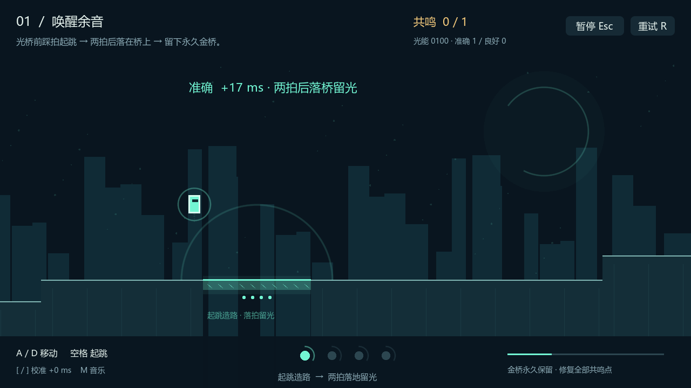
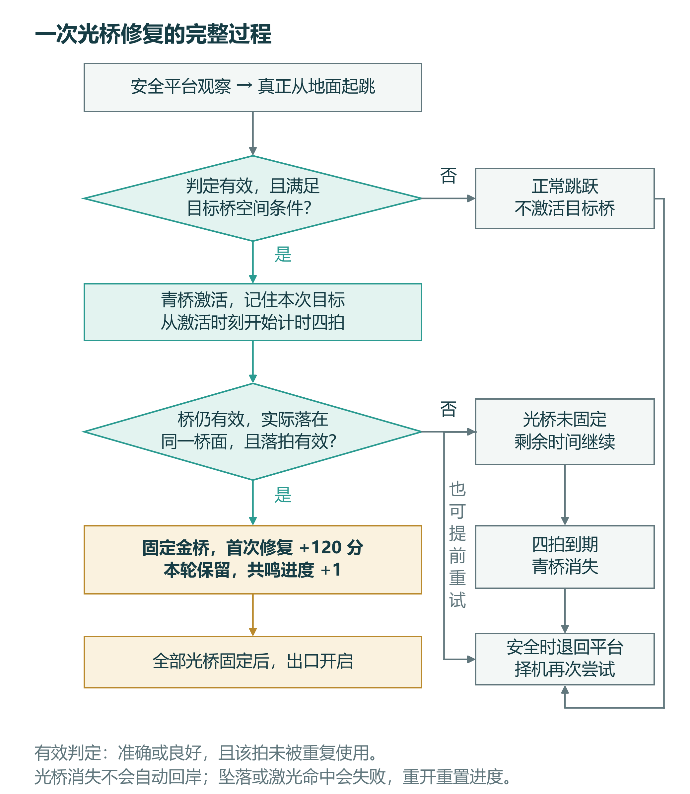
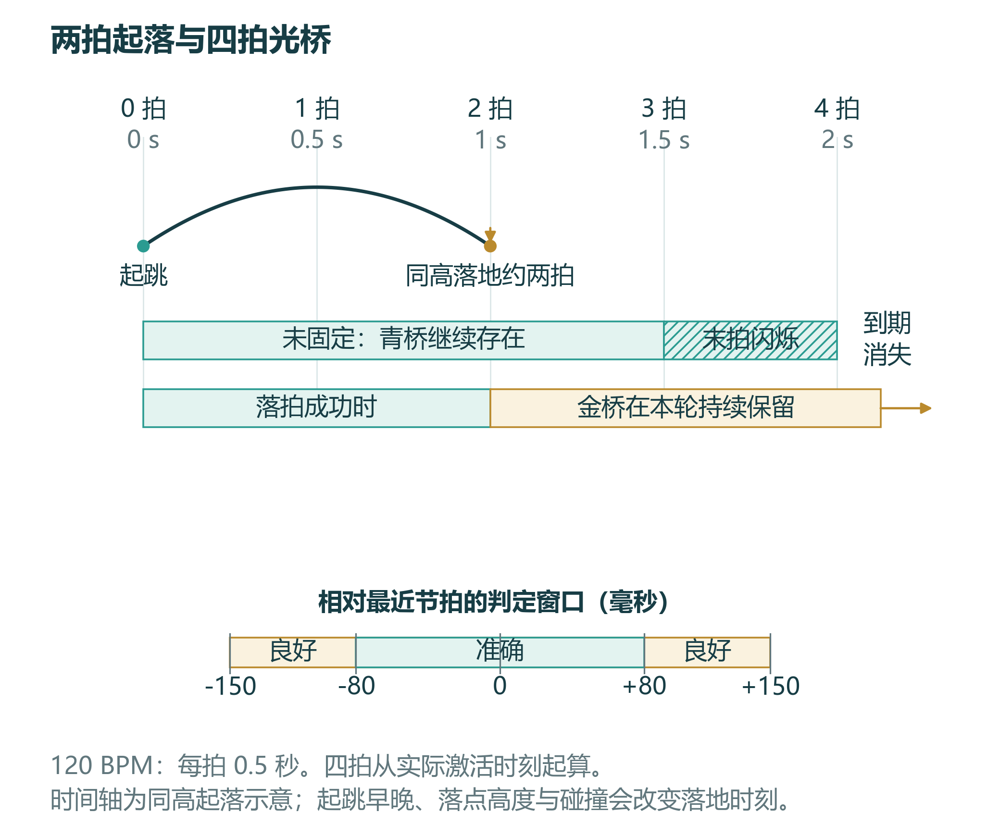
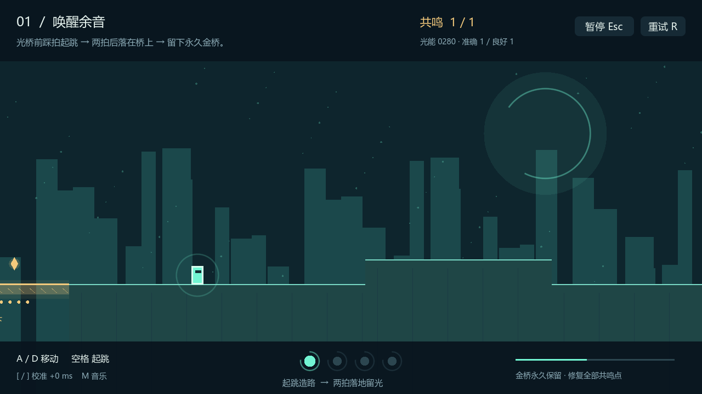
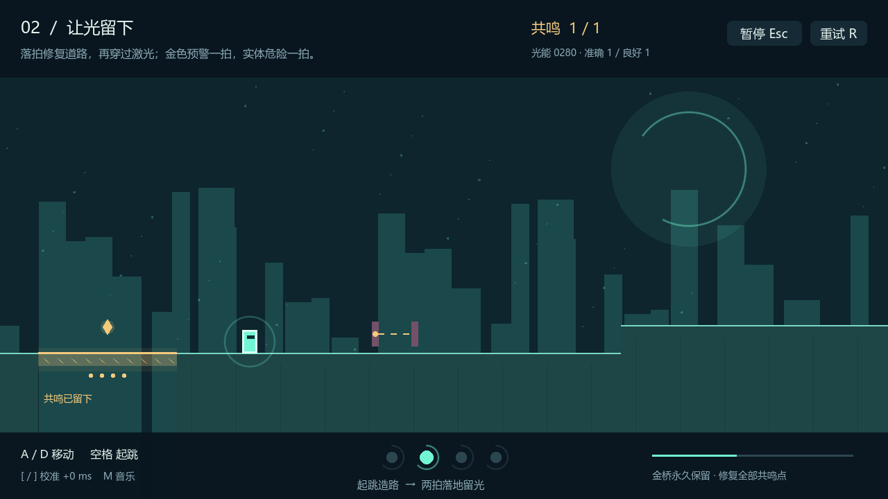
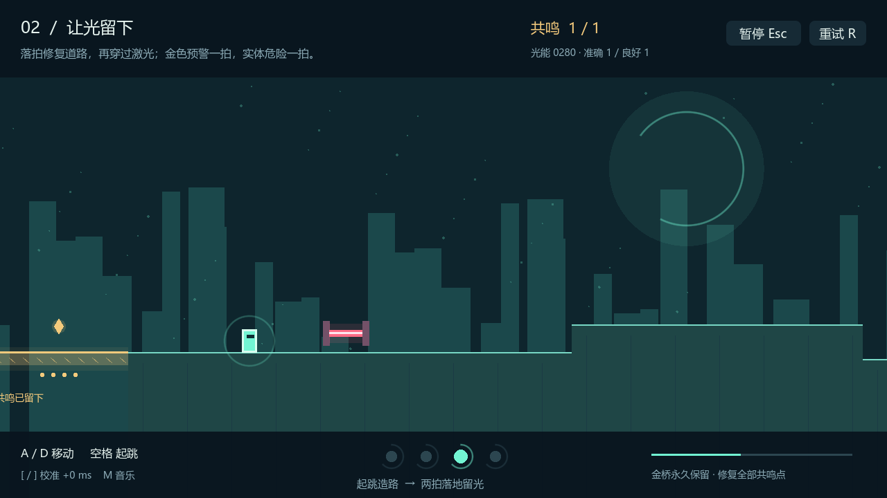
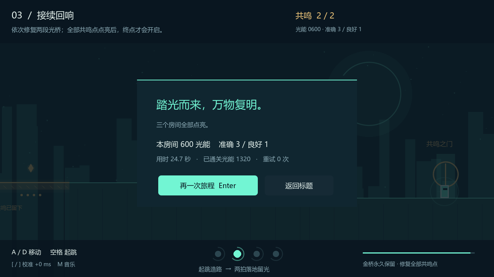
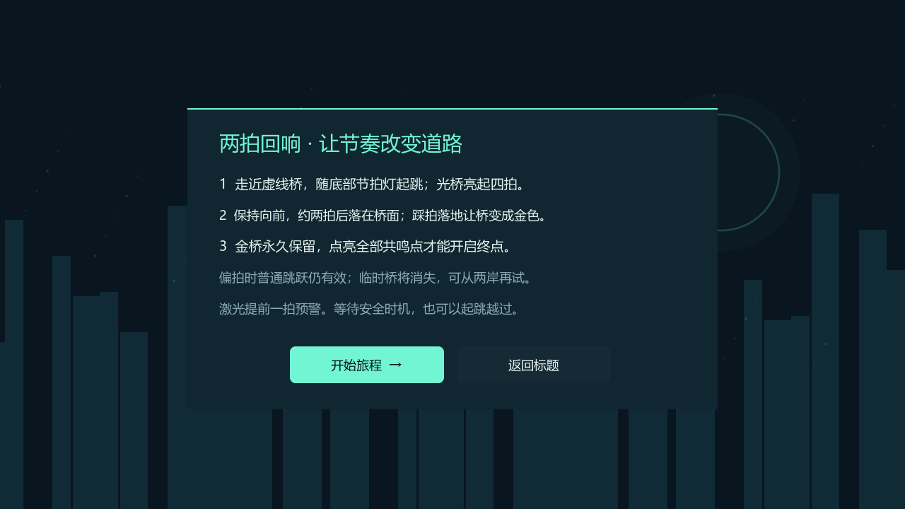
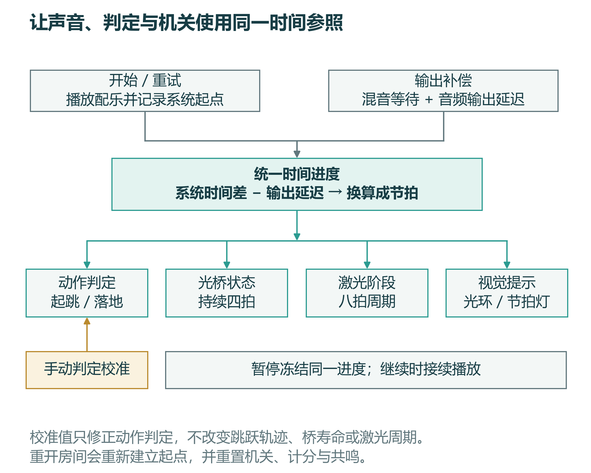

# 《踏光：两拍回响》游戏策划案

Treadlight · v0.2 · 2026年10月25日

[阅读图文版 PDF](design/game-design.pdf) · [下载可编辑 Word](design/game-design.docx) · [人员分工与活动安排](team-schedule.md)

下文页码按 PDF 阅读版标示。

图 1  游戏实录  踩拍落桥后，金色通路在本轮尝试中留下。

《踏光：两拍回响》将节拍判断放进一次完整的跳跃：起跳唤醒临时通路，落地完成修复。玩家沿着三间遗迹前行，让短暂的起落留下可以继续走过的道路。

本策划案说明作品立意、核心规则、关卡安排、视听表现和实现方式。截图取自当前可玩版本，流程与布局图依据实际工程绘制；尚待完善的内容在相应章节单独说明。

团队成员  严楷哲  沈语雯  李星莹

队长  严楷哲

## 01 项目概述

《踏光：两拍回响》是一款单人节奏平台跳跃游戏。玩家在失去光亮的遗迹中前进，借助音乐节拍修复断开的道路：踩拍起跳时，青色光桥出现；随后踩准节拍落在桥面上，光桥便固定为金色通路。修复房间内的全部共鸣点后，出口开启。

游戏的主要操作只有左右移动和跳跃。玩家在地面上可以随时起跳，落地也不需要额外按键；需要学习的是何时出发、落在哪里，以及何时应当停下等待。节拍决定道路状态，空间位置决定动作是否有效，两者共同构成一次修复。

当前版本包含三个短房间，提供标题页、规则教学、暂停、失败重试、计分、节拍校准和最终结算，已形成从开始到通关的完整流程。游戏以 Windows x64 为当前运行平台，使用 Godot 4.4.1 Standard 和 GDScript 实现。作品面向愿意尝试节奏与平台跳跃的玩家，按键数量较少，但仍保留观察时机与控制落点的挑战。

| 项目 | 当前版本 |
| --- | --- |
| 类型与平台 | 单人节奏平台跳跃；Windows x64 |
| 核心动作 | 左右移动、地面单次跳跃、自动落地判定 |
| 关卡规模 | 三个房间，逐步组合光桥与激光 |
| 通关目标 | 固定房间内全部光桥，再抵达出口 |
| 实现工具 | Godot 4.4.1 Standard；GDScript |

### 阅读顺序

第3页从立意与场景出发；第4—7页解释一次修复及其判定；第8—11页展开三个房间；第12—15页说明画面、声音、界面与时间同步；第16—17页记录当前验证和团队安排。

## 02 创作立意与环境叙事

### 让动作留下道路

作品围绕“律动”展开。音乐提供稳定的拍点，角色的一次起落对应两次节奏回应：起跳唤醒通路，落地使通路稳定。原本只持续片刻的动作，因此会在场景中留下可以再次走过的道路。

这个立意通过游戏规则表达。青桥只存在四拍，说明第一次回应还不稳定；金桥在本次房间尝试中持续存在，标记已经完成的修复。玩家看到的变化依次是虚线断路、青色桥面、金色通路和开启的出口。修复数量增加时，场景也逐步恢复色彩。关卡进展和环境变化指向同一件事：玩家正在让断开的空间重新连接。

“两拍回响”同时描述动作长度和体验结构。在相同高度起落时，角色飞行约一秒，恰好接近 120 BPM 音乐中的两拍。玩家踩拍起跳后，可以沿着已经听见的节奏预判落地。不同高度会改变实际飞行时间，因此节拍感仍须与眼前的地形相互配合，不能仅靠机械地重复按键完成所有行动。

设计的重点落在一次完整的起落上。分数记录节拍表现，桥面状态则直接决定前进条件。玩家即使暂时不关注分数，也能通过道路是否留下来判断自己有没有掌握规则。

### 沿着遗迹中的回响前进

旅程发生在一片沉寂的几何遗迹。暗色立柱、远处的圆形天体和细小光点构成背景，地面被数处断隙分开。场景仍保留规律的节拍，玩家沿着这些回响寻找可以重新接续的道路。

角色是一个带有微光的简洁形体，轮廓与地面保持清楚的明暗区别。移动时留下短暂的轨迹，周围的光环随节拍收缩。角色没有额外的装备、职业或技能树；画面中的注意力集中在脚下、前方断路和即将到来的拍点。这样的表现也使角色位置和落点便于观察。

三个房间的名称对应旅程中的变化。“唤醒余音”让玩家看到断路第一次回应动作；“让光留下”要求玩家在危险与等待之间保持节奏；“接续回响”把两次修复串成一条完整路线。当前叙事由关卡、色彩和简短提示承担，没有长篇对话或过场。玩家理解环境的主要方式是亲手改变它。

## 03 从青桥出现到金桥固定

每间房间开始时先播放四拍准备，角色暂时不能移动。玩家可以借这两秒听清拍点，再沿安全地面前进。来到断隙旁时，虚线桥提示这里存在一段尚未恢复的通路。

玩家在桥附近踩拍起跳，系统根据实际离地时刻给出“准确”或“良好”判定。附近的目标桥随即变为青色实体，开始四拍计时。角色继续向前运动，在约两拍后落到桥面。如果实际落地也接近拍点，桥面转为金色，出现修复波纹，共鸣进度增加。玩家随后可以站在稳定的桥面上，调整位置或继续前行。

图 2  游戏实录  踩拍起跳唤醒青桥，角色仍需控制落点。

图 3  游戏实录  在本次目标桥上落拍成功后，桥面变金，共鸣增加。

## 04 一次修复的判断流程

时间与位置共同决定修复是否成立。流程图中的“有效判定”包含准确或良好，并要求该拍未被重复使用。

图 4  修复流程示意  本次目标、有效桥面与落拍结果缺一不可。

## 05 两拍起落与四拍光桥

三间房间统一使用 120 BPM，每拍 0.5 秒。准确和良好均能触发桥面交互，区别主要体现在反馈与得分。普通起跳和踩拍起跳共用同一套速度、重力与碰撞规则，节拍不会突然改变跳跃高度。玩家学习一条稳定的轨迹后，可以把注意力转向出发时机和目标位置。

图 5  节拍时间示意  同高起落约两拍，四拍从实际激活时刻开始。

| 项目 | 当前规则 | 对体验的影响 |
| --- | --- | --- |
| 准确 | 距最近拍点不超过 80 毫秒 | 对更精确的动作给予较高评价 |
| 良好 | 超过 80 毫秒、但不超过 150 毫秒 | 仍能激活和固定桥面，保留练习余地 |
| 偏拍 | 距最近拍点超过 150 毫秒 | 保留普通跳跃，不触发节拍机关 |
| 青桥寿命 | 从实际激活时刻起持续四拍 | 同高落桥后通常仍有时间观察或补救 |
| 同高跳跃 | 约两拍 | 为起跳与落地提供可预判的间隔 |
| 开场准备 | 四拍 | 先听见节奏，再开始移动 |

桥的计时从实际激活时刻开始，不向前取整到最近拍点。因此，落在判定窗口边缘的有效起跳也能获得完整的四拍。末拍闪烁把剩余时间变成可见的信息，玩家不必一直在心中计数。

## 06 落点 容错与计分

### 为什么要落在桥上

桥宽与移动参数共同保证了这一动作有明确的空间意义：同高跳跃约持续一秒，以每秒 140 像素的速度前进，理想水平位移约为 140 像素；当前光桥宽 200 像素。玩家需要利用桥面落脚并继续通过，不能依靠一次普通同高跳跃直接越过整段断隙。落在桥上的过程因此成为路线的一部分。

出口检查的是全部光桥是否固定。走到终点附近、临时点亮青桥或获得较高分数，都不能替代修复。这一条件要求玩家完整经历“造路—落桥—留光”，并通过共鸣数量确认还剩下多少目标。

### 动作必须真实发生

判定发生在角色真正离地和着地时，按下跳跃键本身不会直接授予结果。角色在空中连续按键不能形成新的地面起跳；同一拍的有效动作也不会反复接受。桥面交互还要求角色位于目标桥附近，并且高度相近。远处一次踩拍不会把整间房间的机关全部点亮。

落地固定需要同时满足三个条件：落在本次起跳关联的目标桥上，桥仍然有效，落地时刻在有效窗口内。落回普通平台、落错目标或只是从桥边经过，都不构成修复。规则把时间判断与碰撞结果对应起来，避免画面上没有真正落桥却获得奖励。

### 失误后的选择

如果起跳偏拍，角色仍会按正常轨迹跳起，但光桥不会出现。如果桥已激活而落地偏拍，桥仍保持青色，剩余时间继续减少。玩家应根据站位选择回到岸边或再次尝试，最后一拍的闪烁提示会提醒桥即将消失。尚未固定的桥可以从任一岸重新接近和激活；已经固定的桥则保留本次尝试的成果。

安全平台允许玩家停下等待，房间没有迫使玩家一直前进的总倒计时。第一次没踩准时，可以重新听拍后出发。临时桥的期限只约束当前修复动作，使局部选择带有紧迫感，又不把整段旅程变成持续赶路。

坠落或碰到危险激光后，玩家重试当前房间。重试会重新开始准备拍，清除本房间的桥面状态、目标和得分，已完成房间的成绩不会因当前房间失败而一起重来。金桥的“固定”范围是当前房间尝试，不表示跨重试保存。

### 分数与共鸣各自记录什么

准确起跳计 100 分，良好起跳计 60 分，首次固定一座桥额外计 120 分；落地修复不会再重复叠加起跳分。单座桥只发一次固定奖励。准确、良好和偏拍次数统计起跳，共鸣进度单独记录修复。

当前分数用于呈现动作质量，通关仍由桥面修复决定。不同拍在安全地面有效起跳仍可得分，因此本版不把总分当作严格排名标准。对玩家而言，共鸣数量是更直接的任务信息，分数则提供继续练习节拍的反馈。

## 07 三间房间的路线结构

关卡保持相同音乐速度，通过地形与危险的组合增加要求。每段断路前后都有可落脚的平台，让“观察—行动—整理位置”在空间中分开。桥面与相邻岸边采用同高连接，使核心修复动作对应约两拍飞行；普通地面的高低差负责补充移动变化。

图 6  关卡结构示意  横向依据工程坐标排列，纵向高度作压缩展示。

| 房间 | 场景宽度 | 修复目标与危险 | 主要学习内容 |
| --- | --- | --- | --- |
| 唤醒余音 | 约 2700 像素 | 一座光桥，无激光 | 从青桥出现到金桥固定的完整规则 |
| 让光留下 | 约 3000 像素 | 一座光桥，两处激光 | 区分预警与危险，选择通过时机 |
| 接续回响 | 约 3400 像素 | 两座光桥，两处激光 | 连续修复，并核对全部共鸣进度 |

## 08 唤醒余音

### 先完成一次修复

第一间先用固定地面和高度变化让玩家接触移动，再安排唯一一段断路。桥前平台与桥面同高，起跳到落桥的时间关系较容易观察。这里没有激光，第一次判断失误主要来自节拍、距离或规则理解，玩家不必同时处理伤害机关。

桥后保留较长的安全路段，玩家有机会观察金桥、共鸣计数和出口变化。第一间最重要的学习结果是明白青桥与金桥的差别：出现道路只是第一步，正确落地才完成修复。教学和画面都应围绕这个区别表达。

图 7  第一间游戏实录  修桥后的固定平台为观察与整理位置留出空间。

| 路线阶段 | 玩家面对的问题 | 设计安排 |
| --- | --- | --- |
| 到达断路前 | 怎样移动，何时起跳 | 先经过固定地面与高度变化 |
| 尝试修桥 | 青桥出现是否就算完成 | 用金色变化与共鸣数量确认落拍结果 |
| 修复后前进 | 怎样确认能够离开 | 稳定桥面与较长安全路段用于整理位置 |

这一间应让玩家有机会把操作与结果对应起来。若初次体验者在青桥出现后便离开，应先检查教学是否解释了落地，以及共鸣进度是否足够显眼，再考虑提高难度。

## 09 让光留下

### 把等待纳入行动

第二间继续使用一座桥，让玩家先复用已经学到的修复动作，再在后方遇到两处激光。危险被安排在桥后，使首次识别激光阶段时有固定地面作为参照，也使本关的主要新增问题集中在何时通过。

激光每八拍循环一次，包含一拍预警、一拍危险和六拍安全间歇。预警呈金色虚线，不造成伤害；危险阶段变为粉红色实体光束。两处机关采用不同相位，玩家不能只照搬上一次的出发时机，需要重新观察当前状态。等待一轮安全间歇和用跳跃避开光束，都是可用的路线选择。

图 8  第二间实录  金色虚线为一拍预警，此时尚不造成伤害。

图 9  同一机关的危险阶段  粉红实体光束持续一拍。

## 10 接续回响

### 把局部成功接成路线

第三间安排两座桥，两段修复之间有固定平台和高度变化，每段之后再加入激光。玩家已经见过所有规则，本关要求在更长路线中保持判断，并留意哪些目标已经完成。

第一座金桥成为可见的阶段成果，第二座尚未固定的桥则保留虚线或青色状态。出口需要两处共鸣全部完成，促使玩家核对进度，而不是只追逐画面最右侧。最终完成时，场景进一步变亮，把一路留下的通路与旅程结束联系起来。

图 10  第三间实录  共鸣达到2/2，说明两段修复均已完成。

图 11  最终结算实录  三间点亮后显示本房间和累计表现。

## 11 美术与信息层次

画面采用深蓝黑色背景，前景的角色、桥面和危险区域保持较高亮度。遗迹立柱、远处天体和细小光点以不同速度随镜头移动，形成空间层次；背景形体相对简洁，使玩家能持续辨认脚下边缘和前方落点。

青色用于临时光桥，金色用于固定通路和完成后的共鸣，粉红色用于危险激光。颜色之外，桥面还通过虚线、实体和闪烁区分状态，激光也使用虚线预警与实体光束区分阶段。规则因此不完全依赖颜色差异。修复时的波纹说明动作已经生效，场景随共鸣逐步恢复色彩，呈现局部反馈和整体进展。

角色、遗迹、桥面、激光、光环及波纹均由工程代码实时绘制，项目图标采用 SVG 矢量格式。这样的资源组织便于把图形状态与机关状态同时修改，也便于保持不同尺寸下的轮廓清晰。文字使用操作系统已有字体，中文显示仍需要在实际运行设备上复核。

| 画面对象 | 视觉表现 | 所传达的信息 |
| --- | --- | --- |
| 未激活光桥 | 断隙中的虚线轮廓 | 此处存在待修复目标 |
| 临时光桥 | 青色实体，末拍闪烁 | 现在可站立，但尚未稳定 |
| 固定光桥 | 金色桥面与共鸣标记 | 当前尝试已完成该目标 |
| 激光预警／危险 | 金色虚线／亮色实体光束 | 区分可观察阶段与伤害阶段 |
| 角色光环、底部拍灯 | 持续收缩与四拍循环 | 提供声音之外的节拍参照 |

### 视觉反馈如何服务操作

角色轮廓首先承担定位功能，桥面边缘承担落点提示，明亮光束承担危险提示。三者都在同一操作区域出现，因此背景的对比度需要保持克制。背景随着修复逐步变化，可以让玩家看到长期进展；桥面变色和波纹则要紧跟动作发生，帮助确认眼前这一次操作。

当前通过形态和闪烁补充颜色信息，但这不等于已经完成无障碍适配。后续试玩应观察不同显示器亮度下的虚线、平台边缘和文字辨识情况，避免美术层次影响实际判断。

## 12 配乐与判定感受

当前配乐是一段 120 BPM、16 秒的循环音轨，共 32 拍。节奏打击、较轻的细分节奏、低音和旋律共同构成音乐层次。音轨由工程附带的工具合成，文件与生成代码均随工程保存，便于检查节拍长度和修改声音内容。

稳定的速度让玩家在换房间后继续使用已经建立的节奏感。关卡难度来自布局与危险组合，音乐无需通过突然加速来增加压力。四拍灯和角色光环同时提供视觉参照，音乐开关与手动校准则用于调整实际游玩时的听觉与判定感受。

当前尚未加入独立的修复成功、失败和通关音效。后续声音完善应优先补足这些短反馈，并控制持续时间和响度，避免遮盖玩家用于判断的主拍。该项属于后续打磨内容，不计入本版已完成音效。

图 12  实际校准画面  示例显示+70毫秒；这是一次演示设置，并非推荐默认值。

| 声音与时间项目 | 当前值 |
| --- | --- |
| 音轨速度与长度 | 120 BPM；16秒；32拍循环 |
| 保存格式 | 44.1 kHz；单声道；16位PCM WAV |
| 判定校准范围 | −250至+250毫秒，每次调整10毫秒 |
| 声音资源范围 | 循环配乐已接入；独立事件音效待补 |

## 13 界面与游玩流程

标题页提供开始和玩法说明两个主要入口。规则教学围绕“青桥出现—落拍固定—全部共鸣开门”展开，并解释偏拍后的再次尝试与激光预警。游戏内提示沿用相同术语，减少玩家在不同页面之间重新理解名称的负担。

游玩画面上方集中显示房间名称、目标提示、共鸣数量和分数；短暂的判定文字显示动作结果及时间偏差。下方放置按键提示、校准信息、四拍灯与横向进度条。角色附近的光环提供就近的节奏参照，玩家在观察脚下时仍能注意到拍点变化。

暂停会同时冻结音乐和节拍进度，继续后从原位置恢复。失败页说明失败原因并提供重试入口；完成房间后显示结果，再进入下一间；第三间结束后给出最终结算。重试重新建立房间初始状态和四拍准备，使下一次尝试拥有一致的起点。

图 13  实际玩法说明页面  以青桥、金桥和共鸣出口串起规则。

| 常用操作 | 按键 |
| --- | --- |
| 左右移动 | A／D 或方向键 |
| 地面起跳 | 空格、W 或 ↑ |
| 开始、重试、进入下一间 | Enter，随页面变化 |
| 暂停与继续／重开当前房间 | Esc／R |
| 调整判定校准／音乐开关 | [ 与 ]／M |

## 14 统一的时间参照

节拍交互的基础是同一套时间参照。工程使用单调时钟计算音乐开始后的进度，在开始播放时考虑混音等待和音频输出延迟。起跳与落地判定、青桥寿命、激光周期和界面节拍提示都读取这一时钟。循环音轨重新开始播放片段时，游戏中的拍数继续前进，不把机关计时重新置零。

判定时先加入校准修正，再比较动作时刻与最近拍点的距离。玩家可在 −250 至 +250 毫秒范围内调整，每次 10 毫秒，设置自动保存。校准只修正判定时间，不改变角色跳跃物理；暂停则记录当前进度，继续时重建时间起点，防止把暂停期间经过的时间计入机关周期。

图 14  实现结构示意  判定、机关与提示读取统一进度，校准只修正动作判定。

## 15 实现与验证

程序把角色运动、节拍、机关和房间流程分开处理。角色模块报告实际起跳与落地，房间流程依据这些事件选择目标桥并处理共鸣；桥模块管理碰撞和生命周期，激光模块管理阶段与伤害，界面根据同一状态显示结果。这样的组织让规则变化能够定位到对应职责，也使测试可以分别检查判定边界、机关状态和完整路线。

| 模块 | 主要职责 |
| --- | --- |
| 角色与节拍时钟 | 真实运动事件、音频进度、判定和校准 |
| 光桥与激光 | 桥面状态及碰撞、预警与危险周期 |
| 房间流程 | 布局、目标关联、计分、重试和出口条件 |
| 界面 | 菜单、规则提示、节拍灯与过程反馈 |

关键约束落在事件和状态的一致性上：没有实际离地就不判定起跳，没有被目标桥支撑就不判定修复；桥消失时碰撞与画面同步关闭；重试清除上一轮的目标与机关状态。它们直接关系到玩家能否通过看到的结果理解规则。

### 当前完成情况

v0.2 已实现移动与单跳、统一节拍、临时桥、落拍固定、共鸣出口、激光、三房间、教学、计分、暂停、重试、校准及结算。现有自动检查共 54 项，覆盖判定边界、机关状态、奖励与出口条件等规则，并通过实际角色物理路线验证三间房间可以完成。干净工程导入和 Windows 运行启动检查也已通过。

| 验证项目 | 当前证据 | 可以说明的问题 |
| --- | --- | --- |
| 规则检查 | 54 项自动检查通过 | 已覆盖的判定与状态规则符合预期 |
| 三房间路线 | 自动路线约 18、20、25 秒 | 现有角色参数与关卡路线可通行 |
| 工程与运行包 | 干净导入及启动检查通过 | 工程可导入，运行包可以启动 |

路线时间不含每间约两秒的准备，也不代表首次玩家平均通关时间。首次体验还会包含阅读、等待和重试。当前尚需补充陌生玩家体验与另一台 Windows 设备上的完整通关记录，重点观察玩家是否理解落拍固定、能否区分激光阶段，以及声音、中文显示和暂停恢复是否正常。

后续调整以这些具体观察为依据。若玩家在青桥出现后直接离开，应检查教学与共鸣提示；若声音与按键感受不一致，应记录设备和校准值，再检查同步；若同一位置反复失误，应连同平台高度、起跳距离和提示一起分析。测试记录须写明版本、操作和结果，避免把个人熟练路线当成普遍体验。

## 16 团队分工与后续完善

团队由严楷哲、沈语雯、李星莹三人组成，严楷哲担任队长。职责按程序与版本、策划与视觉、音频与验证分配；涉及共同规则的修改，由对应成员交叉复核。下表说明已确认的职责安排，不替代个人实际完成记录。

| 成员 | 主要职责 | 工作交接与复核重点 |
| --- | --- | --- |
| 严楷哲 | 队长；维护角色、节拍、机关与房间流程；处理程序问题；统一工程与运行版本 | 接收带有复现步骤的问题，说明修复影响，提供统一版本供复测；统筹最终验收 |
| 沈语雯 | 维护玩法、关卡和策划内容；检查教学、落脚点、视觉状态和界面用语 | 将体验问题落实到具体位置与修改建议；复核游戏、策划和展示内容中的规则是否一致 |
| 李星莹 | 检查配乐、校准与暂停恢复；组织功能及设备测试；维护音画与展示材料 | 记录版本、设备、操作和结果；按原步骤复测；检查视频、PPT、讲稿与游戏画面对应 |

程序改动完成后，李星莹复测原问题，沈语雯检查是否改变关卡理解或提示含义；玩法、声音或参数变化也应同步到相关说明。三人共同核对最终版本，具体人员活动与阶段安排见配套《人员分工与活动安排》。

下一阶段优先补充完整试玩和独立设备记录，处理会影响通关、同步和理解的问题，再完善修复、失败与通关的声音反馈。当前三房间已经承载了完整的核心体验，新增房间、变速或额外角色能力不列入这一阶段范围。完善工作的判断标准是现有规则是否清楚、动作反馈是否一致，以及玩家能否在一次旅程中学会并完成“起跳造路，落拍留光”。

### 资料与对应版本

正文对应《踏光：两拍回响》v0.2。实录画面来自当前游戏和介绍视频素材；示意图按角色、光桥、节拍时钟及房间布局绘制。具体活动安排保留在配套的《人员分工与活动安排》中。

完整工程、可运行版本与资源说明：github.com/xunraozhou/treadlight。工程内 docs/assets.md 记录音画内容，docs/development.md 说明运行与检查方法，NOTICE 和 THIRD_PARTY_NOTICES.md 保留相应许可信息。
