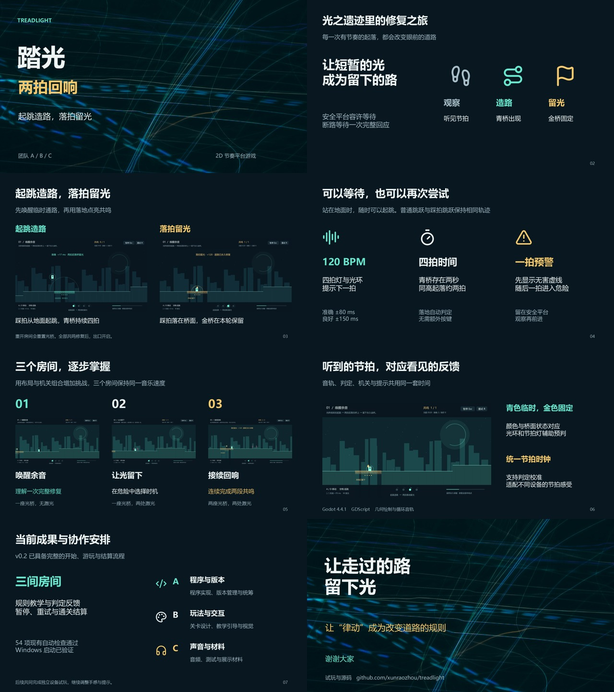

# 《踏光：两拍回响》项目演示

8 页、16:9 的可编辑演示稿，配套约 **4 分 10 秒**的逐页讲稿。沿用游戏的深色、青色和金色，展示“起跳造路，落拍留光”的规则与三房间流程。

- [PowerPoint 演示稿](Treadlight-presentation.pptx)：含逐页讲稿、排练提示与素材来源备注。
- [PDF 预览](Treadlight-presentation.pdf)：由 PowerPoint 导出，便于预览或备用展示。
- [Word 讲稿](Treadlight-speech.docx) · [讲稿 PDF](Treadlight-speech.pdf) · [在线阅读讲稿](speech.md)。
- [素材及素材库清单](asset-sources.md)：实际使用的照片、图标、游戏画面和可供后续使用的资源入口。

## 讲述顺序

| 页码 | 内容 | 建议用时 |
| --- | --- | --- |
| 1 | 踏光：两拍回响 | 28 秒 |
| 2 | 光之遗迹里的修复之旅 | 24 秒 |
| 3 | 起跳造路，落拍留光 | 41 秒 |
| 4 | 可以等待，也可以再次尝试 | 41 秒 |
| 5 | 三个房间，逐步掌握 | 31 秒 |
| 6 | 听到的节拍，对应看见的反馈 | 31 秒 |
| 7 | 当前成果与协作安排 | 31 秒 |
| 8 | 让走过的路留下光 | 23 秒 |

正文与原讲稿一致，本次同步了页名及指图提示。按自然语速完整排练一次，建议将实际时长控制在 4 分至 4 分 30 秒，为换页和停顿留出余量。团队暂用 A / B / C 代称，正式使用前替换姓名并确认实际职责。

## 使用与编辑

用 PowerPoint 打开 PPTX 即可编辑标题、正文及图片。字体为微软雅黑，图片和图标均已内嵌；放映无需联网。演讲者视图可查看讲稿，素材许可说明不需朗读。PDF 是经逐页检查的固定排版版本。

素材源文件位于 `assets/`，来源和许可见素材清单。实际玩法画面均来自本项目。自动兼容性检查的导出结果保留在 Actions 运行附件，不覆盖经检查的发布 PDF 与预览。
